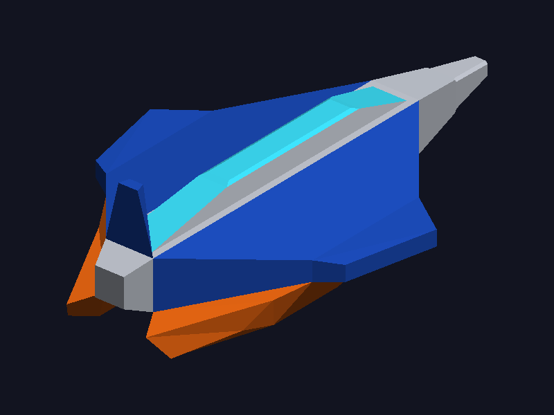

# Lab 4 – Renderizar un modelo OBJ con triángulos

Programa en C++ que carga el modelo OBJ hecho en el laboratorio anterior (una nave
espacial modelada en Blender) y lo dibuja en pantalla rellenando **cada triángulo en
software** sobre un framebuffer propio. SDL2 solo se usa para la ventana, los eventos
y mostrar el framebuffer; GLM para vectores y matrices.



## Estructura

```
models/nave_espacial.obj   modelo del laboratorio anterior (98 vértices, 232 triángulos)
models/nave_espacial.mtl   materiales (solo se usa el color difuso Kd)
src/color.h                color RGBA
src/framebuffer.h          framebuffer en memoria + z-buffer + renderBuffer(renderer)
src/triangle.h             triangle(): rasterizador de triángulos rellenos
src/obj_loader.h/.cpp      cargador OBJ (posiciones y caras)
src/png_writer.h           exporta el framebuffer a PNG (sin librerías externas)
src/main.cpp               init(), setColor(), render() y bucle principal
docs/modelo-renderizado.png  captura real generada por el programa
```

## Dependencias

- Compilador C++17 (probado con g++ 16.2 de MSYS2 UCRT64)
- CMake ≥ 3.16 y Ninja (o cualquier generador)
- SDL2 y GLM

En Windows con [MSYS2](https://www.msys2.org/), desde la terminal **MSYS2 UCRT64**:

```bash
pacman -S --needed mingw-w64-ucrt-x86_64-gcc mingw-w64-ucrt-x86_64-cmake mingw-w64-ucrt-x86_64-ninja mingw-w64-ucrt-x86_64-SDL2 mingw-w64-ucrt-x86_64-glm
```

(En Linux: `sudo apt install build-essential cmake ninja-build libsdl2-dev libglm-dev`.)

## Compilar y ejecutar

Desde la raíz del repositorio (los comandos usan rutas relativas a ella):

```bash
cmake -S . -B build -G Ninja -DCMAKE_BUILD_TYPE=Release
cmake --build build
./build/lab4
```

En Windows el ejecutable es `build/lab4.exe`; CMake copia `SDL2.dll` junto a él y
enlaza el runtime de C++ de forma estática, así que también se puede ejecutar desde
PowerShell (`.\build\lab4.exe`). La ventana permanece abierta hasta cerrarla.

Opcionalmente se puede pasar otra ruta de modelo: `./build/lab4 ruta/al/modelo.obj`.

## Regenerar la imagen

```bash
./build/lab4 --screenshot                  # escribe docs/modelo-renderizado.png
./build/lab4 --screenshot otra-ruta.png    # o en otra ruta
```

El programa dibuja un frame, lo presenta en la ventana y guarda **exactamente los mismos
píxeles** del framebuffer como PNG (RGBA, 800×600, la fila 0 es la parte superior), y
luego termina.

## Cómo funciona

### 1. Carga del OBJ (`src/obj_loader.cpp`)

El archivo se lee **una sola vez** en `init()`:

- `v x y z` → se guarda la posición en `model.vertices`.
- `f ...` → de cada elemento se toma solo el índice de posición, lo que está antes de
  la primera `/`; así se aceptan `v`, `v/vt`, `v//vn` y `v/vt/vn`.
- Los índices OBJ empiezan en 1, por eso se resta 1. Los negativos son relativos al
  final (`-1` = último vértice leído). Un índice 0 o fuera de rango se rechaza con un
  mensaje de error indicando la línea, en vez de leer fuera del vector.
- Las caras de más de 3 vértices se dividen en abanico `(0,1,2), (0,2,3)…` (correcto
  para polígonos convexos; el modelo de la nave ya contiene solo triángulos).
- `mtllib`/`usemtl` se leen para colorear cada cara con el `Kd` de su material.
  Comentarios, `vt`, `vn`, `o`, `s`, etc. se ignoran.
- Archivo inexistente, vacío o sin caras → error y el programa sale con código 1.

### 2. Recorrido de caras (`render()` en `src/main.cpp`)

Es el paso central del ejercicio:

```cpp
for (const Face& face : model.faces) {
    int i0 = face.vertexIndices[0];          // 1. índices de la cara
    int i1 = face.vertexIndices[1];
    int i2 = face.vertexIndices[2];

    glm::vec3 v0 = model.vertices[i0];       // 2. posiciones de los 3 vértices
    glm::vec3 v1 = model.vertices[i1];
    glm::vec3 v2 = model.vertices[i2];

    glm::vec3 c0 = toView(v0), ...;          // 3. centrar y rotar (vista fija)
    ...                                      //    color del material + sombreado plano
    triangle(*framebuffer, toScreen(c0), toScreen(c1), toScreen(c2), currentColor);  // 4.
}
```

### 3. Rasterización (`src/triangle.h`)

`triangle()` recorre el rectángulo que encierra al triángulo, recortado a los límites de
la pantalla, y para cada píxel calcula sus coordenadas baricéntricas con funciones de
arista. Si las tres son ≥ 0 el píxel está dentro y se pinta con
`Framebuffer::point()`, que además comprueba límites y el **z-buffer** (la nave tiene
partes que se tapan entre sí). Los triángulos de área ~0 se descartan.

### 4. Centrado y escalado (`computeView()` en `src/main.cpp`)

1. Se calcula la caja envolvente 3D del modelo y se resta su centro a cada vértice.
2. Se aplica una vista fija de tres cuartos: giro de −40° en Y y 30° en X.
3. Proyección ortográfica: se usan `x, y` del espacio de cámara; se calculan sus
   límites y su centro para que el modelo quede centrado en pantalla.
4. Escala uniforme = `min(ancho disponible / ancho proyectado, alto disponible / alto
   proyectado)`, dejando un 12 % de margen por lado. Si una extensión es 0 no se divide
   entre ella.
5. A pantalla: `x' = W/2 + x·s`, `y' = H/2 − y·s` (la `y` de la pantalla crece hacia
   abajo) y `z` se guarda como profundidad para el z-buffer.
